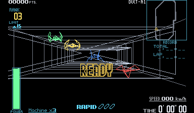
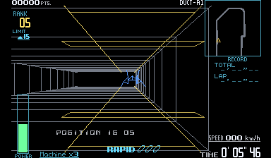
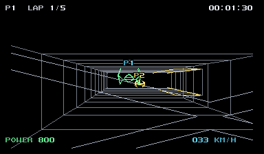
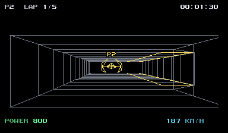
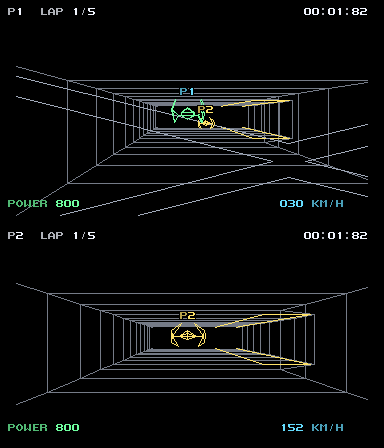
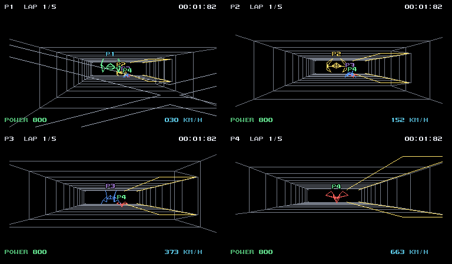

# Zero Racers Recompiled

A recompilation of **Zero Racers** for Virtual Boy, playable on Windows.
Built with [vbrecomp](https://github.com/mstan/vbrecomp) and
[recomp-ui](https://github.com/mstan/recomp-ui).

<p>
  
  
</p>

*Screenshots show the optional color mod. Original red graphics are the default.*

- Play with a keyboard or controller, with customizable controls.
- Adjust fullscreen, window size, filtering and audio through recomp-ui.
- Keep your progress with persistent saves and settings.
- Enable F-Zero-inspired colors: silver tunnels, distinct machines, colored
  menus and HUDs, and yellow repair areas, preserving the original wireframes.

## Play

1. Download the Windows ZIP from [Releases](https://github.com/mstan/ZeroRacersVirtualBoyRecomp/releases/latest).
2. Extract the entire ZIP and run **ZeroRacersVirtualBoyRecomp.exe**.
3. Choose **Browse For ROM**, select your extracted `.vb` file, and press **Play**.

You need your own supported ROM; none is included.

For color, open **Mods**, choose **Install .vbmod**, select the included
`zero-racers-full-color-0.2.1.vbmod`, and enable **Wireframe color**. Turn it off
to return to the original red graphics. The mod does not patch your ROM.

## Controls and settings

**Controller:** Select your connected controller in the launcher. The D-pad or
left stick steers; the right stick handles the Virtual Boy's right D-pad.
Face buttons, shoulders and Start/Select have ready-to-use defaults.

**Keyboard:** Arrow keys and WASD control the two D-pads. X/Z are A/B, Q/E are
L/R, Enter is Start, and Right Shift is Select. Hold Tab for turbo.

Use **Configure** to remap controls and **Settings** for display and audio.
Press **Escape** to open settings during play. Close the game normally to save.

**F7** opens the save-state browser: choose one of twelve thumbnail slots,
press **S** to save or **Enter** to load. **F8** opens the rewind filmstrip:
use Left/Right to browse, Enter to resume there, or Escape to cancel.
Controller shortcuts are Select+R for save states and Select+L for rewind;
A selects/loads, X saves, and B cancels. Both menus pause single-player play.

Rewind keeps 32 snapshots every six frames by default; Settings controls its
enablement, depth and interval. F5/F6 remain quick save/load shortcuts.
Snapshots belong to the current build; native cartridge progress is saved
separately.

## Versus mode

On **Mods**, enable **Multiplayer / VS (Experimental)** before launching. The bundled
mod is installed and disabled by default; turning it off restores the stock
four-choice title. Changes take effect when the game restarts. Then choose
**VS MODE** on the title screen for two to four human racers. Choose
the course and machines, have every racer press A to ready, then start the
race. Assign local controllers in the launcher's controller settings. Two
players share a top/bottom split; three or four use a four-pane layout, with
standings in the spare three-player pane. Each racer sees one eye.
Small P1-P4 tags above visible ships identify each racer in every view.

<p>
  
  
</p>

*Player 1 and Player 2 in a network race, each with an independent camera.
The optional color mod is enabled.*

<p>
  
  
</p>

*Local split screen: two players on the left, four players on the right.*

For remote play, create or join a room through **Netplay** in the launcher.
LAN and Direct IP use the local network; online rooms use the shared lobby
and host ICE transport. Every computer controls one racer and shows that
racer's full view. Use identical game builds, ROMs and enabled mod contents.
There is no mixed couch/online mode, spectator mode or joining a running race.

Start opens a live race menu; the other racers keep moving. Select in that
menu retires your racer. Finished racers wait for the rest; equal-field
finishes tie, and a last survivor wins without a fabricated finish time.
At results, Start rematches, B changes the race, and Select returns to the
title locally or the waiting room online. F10 leaves an online race for its
room; the other peers also return. Losing the host ends that match.

F7/F8 are available between local races and operate on the whole session.
Online, the host can use F7 between races to save or load everyone together;
online rewind is unavailable. Multiplayer execution snapshots are separate
from native single-player cartridge progress.

When updating, close the game and extract the new ZIP into its folder. Keep
`vbrecomp.cfg`, `keybinds.ini`, `saves/` and `mods/` to retain your setup and progress.

## Supported ROM

Extract the ROM from its ZIP before selecting it. The launcher checks that it
matches this revision:

| Cartridge | Value |
|---|---|
| Revision | Zero Racers (Japan, USA) (En) (Switch Online) |
| Size | 1,048,576 bytes |
| CRC32 | `71553796` |
| SHA-256 | `47421cd82dfd414d042d2f7f9db51e657d414d4ddfa46887efb544029fa11ce7` |

## Coverage pass

See [the October 2026 coverage record](docs/COVERAGE-20261018.md) for the
tested gameplay, native/fallback results, reproduction commands and limits.

## For developers

You need Windows 10/11 x64, Git, Python 3.11+ on PATH, MSYS2, and the supported
ROM. Install the build tools in an MSYS2 terminal:

```sh
pacman -S --needed mingw-w64-x86_64-gcc mingw-w64-x86_64-cmake mingw-w64-x86_64-ninja mingw-w64-x86_64-make mingw-w64-x86_64-SDL2
```

Then clone and build from PowerShell:

```powershell
git clone --recurse-submodules https://github.com/mstan/ZeroRacersVirtualBoyRecomp.git
Set-Location ZeroRacersVirtualBoyRecomp
.\tools\build.ps1 -Rom 'C:\Games\zero_racers.vb'
.\build\vbrecomp\runtime\ZeroRacersVirtualBoyRecomp.exe --launcher --rom 'C:\Games\zero_racers.vb'
```

For an existing clone, run `git submodule update --init --recursive` first.
The build script handles code generation and compilation. It expects MSYS2 at
`C:\msys64`; use `-Toolchain` or `-Python` for custom installation paths.

Add `-Build build-release -Production` to build the player version. To try the
color mod after a regular build, run `python tools/play-color.py`.

## License

See [LICENSE.md](LICENSE.md) for project licensing. Dependencies retain their
own licenses. Zero Racers and its artwork belong to Nintendo; see
[artwork attribution](assets/NOTICE.md).

---

<p align="center">
  <b>R.A.I.D. - Retro AI Development</b><br>
  A Discord for AI-assisted retro reverse engineering, decompilation and recompilation.
</p>

<p align="center">
  <a href="https://discord.gg/Ad9BwSzctP"></a>
</p>
